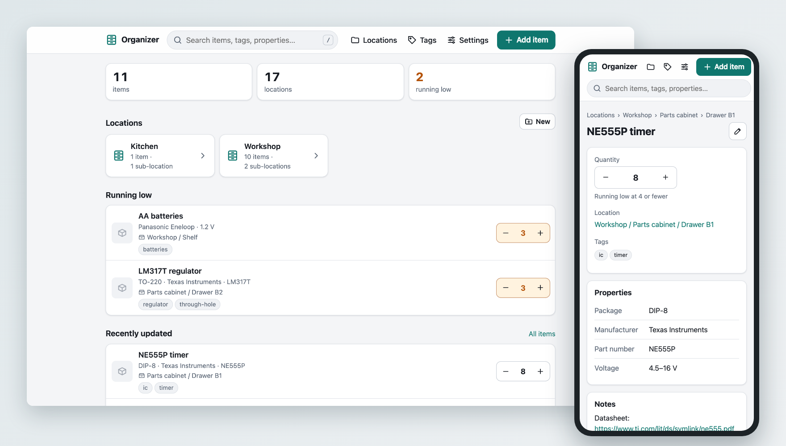

# Organizer

A small self-hosted inventory app for keeping track of where your things are — built for
electronic components spread across drawers, but it works for anything. It runs as a web
server on your computer, and you use it from any browser on your network: desktop or phone.

Kotlin + Ktor on the server, SQLite for storage, server-rendered HTML with a little JavaScript.



## Features

- **Nested locations** — e.g. Workshop › Parts cabinet › Drawer A3. Create a whole cabinet at once
  with ranges: `Drawer {1-24}`, `{A-D}{1-6}` (A1…D6) or `Bin {01-12}`.
- **Items** with quantity, tags, free-form properties (`Package: 0805`, `Voltage: 16 V`), notes and a photo.
- **Quick − / + buttons** to update stock right from any list, plus optional low-stock warnings.
- **Search** across names, tags, properties and notes. Matches parts of words (`317` finds `LM317T`),
  ignores case and accents, and updates as you type. Press `/` on any page to jump to it.
- **QR labels** — print labels for drawers and boxes; scanning one with your phone camera opens that location.
- **Take photo** — opens the camera on phones, and the webcam on computers (photos are shrunk before uploading).
- **Fill in with AI** — with an Anthropic API key, Claude recognizes the item from its photo (a bag of
  resistors, a banana, a bottle of detergent), its typed name, or both, reads any label and fills in the
  name, quantity, tags and properties for you to check.
- **Exports** — CSV for spreadsheets, and a one-click backup of the whole database.

## Running it

The app runs in Docker. In this folder:

```sh
docker build -t organizer .
docker run -d --name organizer --restart unless-stopped -p 8080:8080 -v organizer-data:/data organizer
```

`docker logs organizer` shows where to reach it. Open `http://localhost:8080` on this computer,
or this computer's network address, such as `http://192.168.1.20:8080`, on your phone (it must be on
the same Wi-Fi). Tip: use "Add to Home Screen" in your phone's browser for an app-like icon.

Your data is kept in the `organizer-data` volume, so it survives updates. Settings from
[Configuration](#configuration) are passed with `-e`. Add your
[time zone](https://en.wikipedia.org/wiki/List_of_tz_database_time_zones), such as
`-e TZ=Europe/Berlin`, so dates are in local time rather than UTC.

To deploy each new version automatically on a Windows machine, see
[Deploying on Windows with Jenkins](docs/jenkins.md).

### Updating

Get the new version (e.g. with `git pull`), then build the image again, stop the app and back up the
database:

```sh
docker build --pull -t organizer .
docker stop --time 30 organizer && docker rm organizer
docker run --rm -v organizer-data:/data --entrypoint /app/backup.sh organizer
```

and run the `docker run` line above again, with the same settings.

The backup goes to `backups/` in the volume, where the last 5 are kept (see
[`docker/backup.sh`](docker/backup.sh)). It's there for undoing an update: a new version may upgrade
the database on its first start, and older versions can't read the upgraded file. To go back to a backup:

1. Stop the app with `docker stop organizer`.
2. List the backups with
   `docker run --rm -v organizer-data:/data --entrypoint ls organizer /data/backups`.
3. Copy one over the database, replacing `<backup>` with its name:
   `docker run --rm -v organizer-data:/data --entrypoint sh organizer -c "rm -f /data/organizer.db-wal && cp /data/backups/<backup>/* /data/"`
4. Start the app with `docker start organizer`.

### Without Docker

With JDK 21 or newer installed, `./gradlew run` starts the app on port 8080, with its data in `data/`
in this folder. Settings are environment variables here too, e.g. `ORGANIZER_PORT=9000 ./gradlew run`.

## Configuration

Everything is optional and set through environment variables, passed to the container with `-e`:

| Variable               | Default                                        | Meaning                                                                       |
|------------------------|------------------------------------------------|-------------------------------------------------------------------------------|
| `ORGANIZER_PASSWORD`   | *(none)*                                       | Ask for this password on every page (any username works). See [Security](#security). |
| `ORGANIZER_PUBLIC_URL` | *(from the request)*                           | Address printed into QR labels, e.g. `http://organizer.lan:8080`.              |
| `ORGANIZER_MACHINE_ID` | *(found by the app)*                           | This computer's ID, which the saved API key is tied to; needed in Docker (see [How the API key is kept](#how-the-api-key-is-kept)). |
| `TZ`                   | UTC in Docker                                  | Time zone for dates, e.g. `Europe/Berlin`.                                    |
| `ORGANIZER_PORT`       | `8080`                                         | Port the app answers on. In Docker, change the first port of `-p` instead, e.g. `-p 9000:8080`.  |
| `ORGANIZER_HTTPS`      | `false`                                        | `true` answers over HTTPS instead of HTTP. See [HTTPS](#https).               |
| `ORGANIZER_HOST`       | `0.0.0.0`                                      | Address to listen on; `127.0.0.1` lets only this computer in.                  |
| `ORGANIZER_DB`         | `/data/organizer.db` in Docker, `data/organizer.db` otherwise | The database file; `secret.key` is kept next to it.            |

The Anthropic API key for *Fill in with AI* isn't an environment variable: it's entered on the
**Settings** page (in the top bar of every page).

## Taking photos

On the item form, **Take photo** opens the camera:

- On phones and tablets it opens the camera app, and the photo goes straight into the form.
- On a computer with a webcam it shows the camera on the page. Press **Take photo** (or Enter) to use
  the picture, or **Switch camera** if there's more than one. Browsers only let pages use a webcam on
  `localhost` or over HTTPS, so the button appears when you open the app on the computer it runs on
  (`http://localhost:8080`) or over [HTTPS](#https), but not at an address like
  `http://192.168.1.20:8080`. **Choose photo** works everywhere.

## HTTPS

To use the webcam from another computer on your network, turn on HTTPS. The app then answers over
HTTPS instead of HTTP, on the same port:

```sh
docker run -d --name organizer --restart unless-stopped -p 8080:8080 \
  -e ORGANIZER_HTTPS=true -v organizer-data:/data organizer
```

and you open `https://192.168.1.20:8080`; `http://` addresses stop working. The app makes its own
certificate, `https.p12` in the volume, so the browser warns about it the first time: choose
*Advanced* and continue (Chrome, Edge, Safari), or *Accept the risk* (Firefox), once on each device.
QR labels point to HTTPS too, so a phone that scans one gets the warning the first time as well.

The certificate names `localhost`, this computer's network addresses and the address in
`ORGANIZER_PUBLIC_URL`. In Docker the app can't see the computer's addresses, so if you want the
certificate to name yours, set `-e ORGANIZER_PUBLIC_URL=https://192.168.1.20:8080`. Continuing past
the warning works either way. A new certificate is made when that address changes and before the
old one expires (after about two years), and then the browser warns once more.

## Filling in items with AI

With an Anthropic API key, the item form gets a **Fill in with AI** button. Claude (Anthropic's
Claude Haiku 5.5) works out what the item is from what you give it:

- **a photo**: it reads any label or packaging, such as bag labels from LCSC, Digi-Key and Mouser,
  the marking on a chip, or the front of a box or bottle;
- **a typed name**, such as `NE555P` or `Persil Universal Gel 1.5 L`: it fills in what it knows
  about that exact item;
- **both**: the name tells it what it's looking at, and the photo's label keeps it accurate.

It fills in the name, quantity, tags such as `resistor` and `smd` or `food` and `fruit`, properties
like brand, size, part number, manufacturer, package and voltage, and a short note. It only fills
empty fields, highlights what it filled in, and never saves anything by itself, so check the
suggestions before saving. Choosing a photo for a new item that has no name yet fills the form in
straight away.

Filling in doesn't search the web: Claude answers from the photo, the name and what it knows.

**Find photo**, next to Choose photo, looks up a photo of the item by its typed name. Claude searches
the web and names up to five pages from different sites that show the item, such as the maker's
product page, shops and marketplaces. Organizer downloads those pages' product photos and puts one
in the photo field, preferring a photo on a white or transparent background. The status line says
which site it's from, or which sites didn't give one. Organizer only downloads
from addresses on the public internet, never from this computer or the local network, and
identifies itself honestly, so sites that block automated downloads (many large shops and makers'
sites answer 403) don't give a photo. **Settings › Logs** shows the pages Claude named and why each
one didn't work.

To set it up:

1. Create an API key at [console.anthropic.com](https://console.anthropic.com/settings/keys) (the
   account needs some credit). A Claude.ai subscription doesn't include API use.
2. Open **Settings** (in the top bar), paste the key and save. The app checks it with
   Anthropic first.

What it costs: Anthropic bills the account per use. Filling in costs about $0.0003 from a photo and
$0.0002 from a typed name (100 photos cost about 3¢), and takes about 2 seconds. **Find photo**
searches the web, at 1¢ a search, so it costs 1 to 3¢ each time and takes 5 to 10 seconds.
**Settings** names the model and shows what AI has cost this month and in total, worked out from
Anthropic's list prices for every question asked. The bill itself is in the Anthropic Console.

### How the API key is kept

- It's checked with Anthropic, then stored in the database **encrypted** with AES-256-GCM. Pages
  never show it again, only its last four characters, and it isn't written to the logs.
- The encryption key is made from two parts: a random key file, `secret.key`, which the app creates
  next to the database (readable only by the app's user), and **this computer's ID**. *Download
  backup* and the update backups contain only the encrypted key, and a copy of the data, even with
  `secret.key`, can't decrypt it on another computer. After restoring on another computer, or a
  reinstall of the operating system, enter the key again in Settings.
- The computer's ID is Windows' MachineGuid, macOS's hardware UUID or Linux's `/etc/machine-id`. A
  Docker container can't see the computer it runs on, so there the ID is passed in as
  `ORGANIZER_MACHINE_ID`: the `Jenkinsfile` does this with the Windows machine's MachineGuid. When you
  run the container by hand, pass something unique to the computer, e.g. on Linux
  `-e ORGANIZER_MACHINE_ID=$(cat /etc/machine-id)`, or on Windows
  `-e ORGANIZER_MACHINE_ID=<the MachineGuid from HKLM\SOFTWARE\Microsoft\Cryptography>`. Without it
  the key is still encrypted, just not tied to the computer; Settings says so.
- Anyone who can open the app can *use* the key, though not see it. Set `ORGANIZER_PASSWORD` if
  others can reach the app.

## QR labels

Open a location and choose **Labels** to print codes for it and everything inside it (or use
**Locations › Labels** for all of them). Labels come in three sizes, and you can remove the ones
you don't need before printing.

The codes contain the address you opened the page with, so open it using this computer's network
address (e.g. `http://192.168.1.20:8080`), not `localhost`: inside Docker, the app can't find that
address itself, and the page warns you when the codes wouldn't work on a phone. If your computer's
IP changes, old labels stop working, so give the computer a fixed IP in your router, or set `ORGANIZER_PUBLIC_URL` to a
hostname. Labels contain short links (`/l/12`), and ids are never reused, so a label can't end up
pointing at something else.

## Your data

Everything, photos included, is in one SQLite file, `organizer.db` in the `organizer-data` volume.
Next to it, `secret.key` encrypts the saved API key (see [How the API key is kept](#how-the-api-key-is-kept)).

- **Backup:** use *Download backup* in Settings. It's safe to do while the app is
  in use. To restore, stop the app (`docker stop organizer`), then, in the folder
  with the downloaded file, run
  `docker run --rm -v organizer-data:/data -v "${PWD}:/restore" --entrypoint sh organizer -c "rm -f /data/organizer.db-wal && cp /restore/<file> /data/organizer.db"`
  with `<file>` replaced by its name, and start the app again (`docker start organizer`).
- **Export:** *Export CSV* in Settings gives you all items for a spreadsheet.

## Offline and private

The app has no accounts, analytics or update checks. Pages load nothing from other sites (no CDNs or
web fonts, and the browser is told to block anything that isn't from the app itself).

The internet is used only for:

- **Building** (`docker build` or `./gradlew`), which downloads the Java base images, Gradle and the
  libraries. The built image doesn't need them.
- **Fill in with AI**, once an API key is saved: the item's photo and typed name go to Anthropic's
  API, when you press the button or choose a photo for a new item that has no name yet. **Find photo**
  also downloads the photo from the page Claude found. Without a key, the app makes no outside
  connections at all.

## Security

There is no login by default: anyone who can reach the app on your network can view and edit
your inventory. Set `ORGANIZER_PASSWORD` if that matters to you, and make it long, such as four
random words: after 10 wrong passwords within a minute, the app makes that address wait a minute,
which slows guessing down but can't save a short password. Don't expose the app directly to
the internet. If you want remote access, put it behind a reverse proxy with HTTPS (and the password),
or use a VPN such as Tailscale. Form posts from other websites are rejected, and the reverse proxy
must pass the original `Host` header through for that check to work.

## Development

```sh
./gradlew test   # unit tests plus HTTP tests against a temporary database; Claude is replaced by a stand-in
./gradlew run    # the app on port 8080, with its data in data/
```

GitHub Actions runs the tests and builds the Docker image for every push and pull request.

```
src/main/kotlin/organizer/
  Main.kt                    entry point and configuration
  RecentLogs.kt              the latest log lines, kept for the Logs page in Settings
  ai/                        Fill in with AI: the Claude client, the question and its answer, the saved key,
                             photo downloads (WebPhotos.kt)
  db/                        SQLite access and schema migrations
  model/                     data classes, location tree, search normalization, name ranges
  store/                     repositories (all SQL lives here), settings and their encryption, AI usage
  web/                       Ktor setup, routes and HTML views (kotlinx.html)
src/main/resources/static/   app.css, app.js (progressive enhancement, no build step)
```

What Claude is asked about each photo or name, and how its answer becomes item fields, is in
`ai/ItemSuggestion.kt`, with examples in `ItemSuggestionTest`; that's the place to change what it
fills in.

Schema changes go in `db/Migrations.kt` as a new entry; existing databases upgrade on startup.

## License

[MIT](LICENSE)
